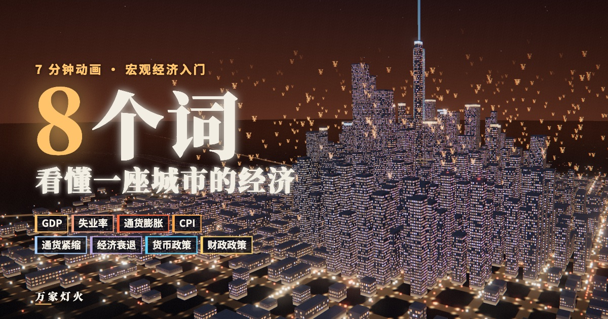

# 万家灯火 · 8 个词看懂一座城市的经济

在线体验：<https://eason-xi.github.io/macro-economy-city/>

一座会呼吸的三维夜城。每一扇亮着的窗后面，都有一份工作、一笔收入、一次消费；把整座城市的灯火加在一起，就是一个经济体。

页面用这座城市讲清宏观经济的 8 个基本名词：

| 名词 | 城市里的样子 | 可以动手试的 |
|---|---|---|
| GDP 国内生产总值 | 城市的总亮度，车流按消费、投资、政府购买、净出口染色 | 一块面包的旅程：为什么只算最终产品 |
| 失业率 | 窗户成片熄灭 | 拖动 100 人点阵，看城里的窗一扇扇暗下去 |
| 通货膨胀 | 城市发烧：窗光变红、热浪扭曲、¥ 像火星一样升起 | 调通胀率，看 100 元的购买力缩水 |
| CPI 居民消费价格指数 | 城市的体温计 | 拖动购物篮里各类商品的涨跌，看权重怎样起作用 |
| 通货紧缩 | 城市结冰、下雪、车流变慢 | 通缩螺旋 |
| 经济衰退 | 街区一片片停电 | 经济周期与「连续两个季度负增长」 |
| 货币政策 | 央行塔的潮汐：降息时青色光环扩散，加息时红色光环收拢 | 亲手降息、加息 |
| 财政政策 | 政府开工，新区拔地而起，金色涟漪一圈圈传开 | 乘数效应：1 元怎样变成 5 元的需求 |

最后有一个宏观沙盘：你同时掌管利率和财政支出，还可以制造金融危机、石油危机或消费狂热，看城市如何应对。

## 使用说明

- 建议用电脑浏览器、打开声音体验；手机也能看。
- 在画面空白处拖动可以旋转城市。
- 页面中的数据均为教学示意；中国 GDP 数据来自国家统计局对 2024 年的初步核算。

## 技术

单个 HTML 文件，无需构建：Three.js（自定义着色器渲染约两千栋建筑的窗格、一万多个车流光点、泛光后期）、Web Audio 生成式音效、Canvas 绘制的小图表。依赖从 jsDelivr 与 Google Fonts 加载。
